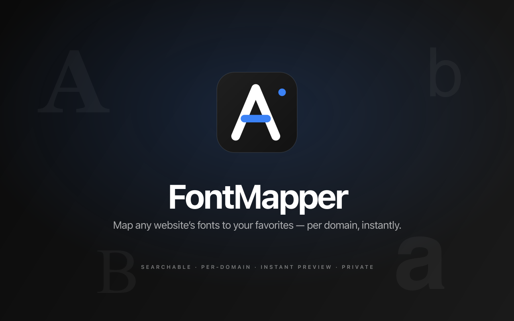
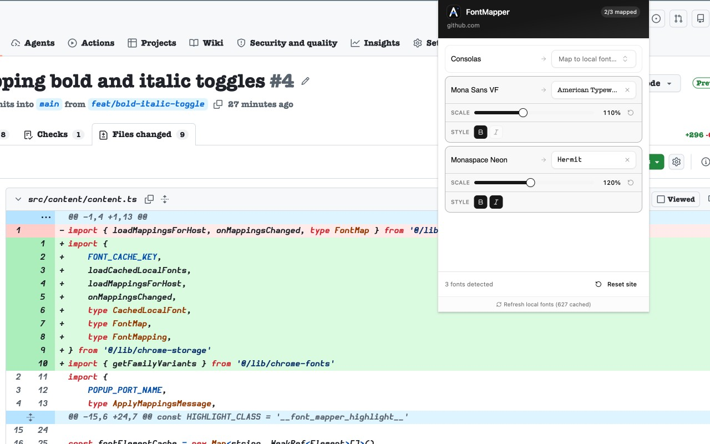
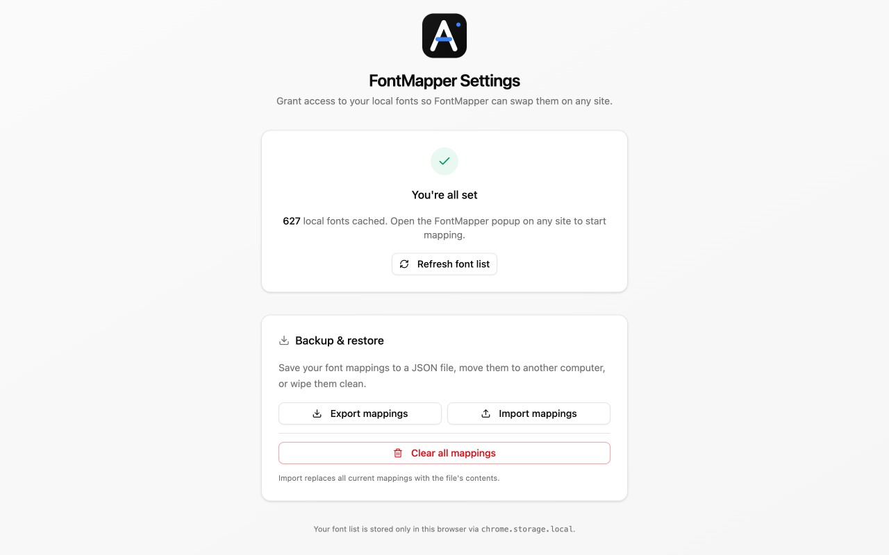

<div align="center">


# FontMapper

**Replace any website's fonts with the fonts installed on your computer — per domain, instantly.**

<sub>System fonts, downloaded fonts, anything — FontMapper reads them directly via Chrome's Local Font Access API and lets you assign any of them as a replacement on any site.</sub>

<p>
  <a href="https://chromewebstore.google.com/detail/gfdmhpidmomcbghfoejkcpjdklbdcdnn"></a>
  <a href="LICENSE"></a>
  <a href="https://github.com/Jubstaaa/font-mapper/stargazers"></a>
</p>

<p>
  <a href="https://chromewebstore.google.com/detail/gfdmhpidmomcbghfoejkcpjdklbdcdnn"></a>
</p>

</div>

<p align="center">
  
</p>

---

## What it does

FontMapper is a Chrome extension that lets you change website fonts using the fonts already installed on your computer. Open the popup on any page, see every font family the site is using, swap each one for any font on your machine, and FontMapper remembers your choices — per domain, applied automatically on every visit.

Built for people who care about typography, accessibility, or just don't like how a particular site renders its body text.

## Features

- **Per-domain mapping** — different replacements for different sites, applied automatically
- **Cross-device sync** — mappings follow your Chrome profile to every device signed in to the same Google account, no export/import needed
- **Searchable font picker** — type to filter through every font on your machine; each option previews in its own typeface
- **Per-mapping typography** — tweak scale, bold/italic, line-height, letter-spacing, word-spacing, and text color for each remapped family
- **Hover to identify** — hover any detected font in the popup and every element using it gets highlighted on the page
- **Instant preview** — changes apply in real time, no reload
- **One-click reset** — wipe all mappings for a site
- **Zero data collection** — no FontMapper servers, no analytics, no accounts; mappings ride Chrome's encrypted profile sync

<p align="center">
  
</p>

<p align="center">
  
</p>

## How it works

FontMapper walks every element on the page, reads its computed `font-family` chain, and applies an inline override on each element whose chain references a mapped family:

```js
el.style.setProperty('font-family', '"Product Sans"', 'important')
```

This intercepts named families (Arial, Sohne), generic keywords (`sans-serif`, `serif`, `monospace`), and system aliases (`-apple-system`, `system-ui`) — anywhere a page's font stack falls back, your mapping wins. A `MutationObserver` keeps it up to date as the page injects new content.

Per-domain preferences are persisted via `chrome.storage.sync` so they follow your Chrome profile across devices. There are no FontMapper servers — Google's encrypted profile sync is the only network path.

## Install

### From the Chrome Web Store

[**Install FontMapper from the Chrome Web Store →**](https://chromewebstore.google.com/detail/gfdmhpidmomcbghfoejkcpjdklbdcdnn)

One click, no setup. Works on any Chromium-based browser (Chrome, Edge, Brave, Arc).

### From source

```bash
git clone git@github.com:Jubstaaa/font-mapper.git
cd font-mapper
bun install
bun run build
```

Then in Chrome:

1. Open `chrome://extensions`
2. Enable **Developer mode** (top-right toggle)
3. Click **Load unpacked**
4. Select the `dist/` folder

## Development

```bash
bun install
bun run dev        # Vite dev server + HMR (dist/ auto-rebuilds)
bun run build      # Production build → dist/
bun run typecheck  # tsc -b --noEmit
```

## Tech stack

| Layer        | Tools                                                            |
| ------------ | ---------------------------------------------------------------- |
| Build        | Vite, [@crxjs/vite-plugin](https://crxjs.dev), Bun               |
| UI           | React 19, TypeScript, Tailwind CSS v4                            |
| Components   | shadcn/ui (new-york), Radix UI, cmdk, lucide-react               |
| Browser APIs | Local Font Access, `chrome.storage.sync/local`, `chrome.action`, `chrome.tabs`, MV3 service worker + ports |

## Project structure

Flat per-feature folders. Each feature owns its component, types, and (when business logic exceeds the component) a colocated hooks file.

```
src/
├── background/                       MV3 service worker
│   ├── background.ts                 Entry — wires the two register fns
│   ├── badge.ts                      Per-tab mapping count badge
│   └── lifecycle.ts                  onInstalled / onStartup / migration trigger
├── content/                          Injected into every page (document_start)
│   ├── content.ts                    Entry — init + IPC + lifecycle listeners
│   ├── content.types.ts              InlineSnapshot, OverrideState
│   ├── font-chain.ts                 Pure parsers: parseFontFamilyChain, matchChain
│   ├── element-override.ts           Apply / restore inline style per element + state
│   ├── used-fonts.ts                 collectUsedFonts + chain/element caches
│   ├── highlight.ts                  Hover-highlight CSS injection
│   └── observers.ts                  MutationObserver + resize debouncer
├── popup/                            Browser action UI
│   ├── popup.tsx                     JSX wiring
│   ├── popup.hooks.ts                usePopupController owns state + IPC
│   ├── popup.types.ts
│   ├── font-mapping-row.tsx          One mapping row (source → target + controls)
│   ├── font-mapping-row.types.ts
│   ├── labeled-slider.tsx            Reused by Scale + Line + Letter + Word
│   ├── advanced-color.tsx            Native color picker with reset
│   ├── style-toggles.tsx             Bold + Italic buttons
│   ├── mapping-warning.tsx           Orphan / missing-target banner
│   ├── font-combobox.tsx             Searchable combobox (cmdk + Radix Popover)
│   └── font-combobox.types.ts
├── options/                          Settings page (Local Font Access + backup)
│   ├── options.tsx                   JSX wiring
│   ├── options.hooks.ts              useFontAccess + useBackupActions
│   └── options.types.ts
├── hooks/
│   └── use-debounced-commit.hooks.ts Shared draft + commit debounce
├── lib/
│   ├── chrome-storage.ts             CRUD over chrome.storage.sync (with local fallback)
│   ├── chrome-storage.types.ts       Shape definitions
│   ├── chrome-storage-migration.ts   One-shot local → sync migration
│   ├── chrome-fonts.ts               Local Font Access enumeration + variant picking
│   ├── chrome-messaging.ts           Type-safe popup ↔ content messages
│   └── utils.ts                      shadcn cn helper
├── components/ui/                    shadcn primitives (slider, popover, tooltip, …)
├── main.tsx                          Popup React entry
└── index.css                         Tailwind + design tokens

public/                               Manifest icons (16/32/48/128)
store/                                Chrome Web Store assets + listing copy
```

## Privacy

FontMapper does not collect, transmit, or store any data outside of your browser's local storage. No analytics. No telemetry. No accounts. The full source is in this repo.

## License

MIT

---

<div align="center">

If FontMapper made your day a little better, [**leave a review on the Chrome Web Store**](https://chromewebstore.google.com/detail/gfdmhpidmomcbghfoejkcpjdklbdcdnn) or ⭐ this repo. It really helps.

</div>
